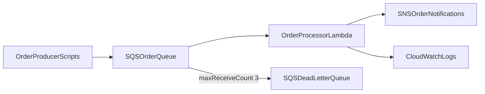
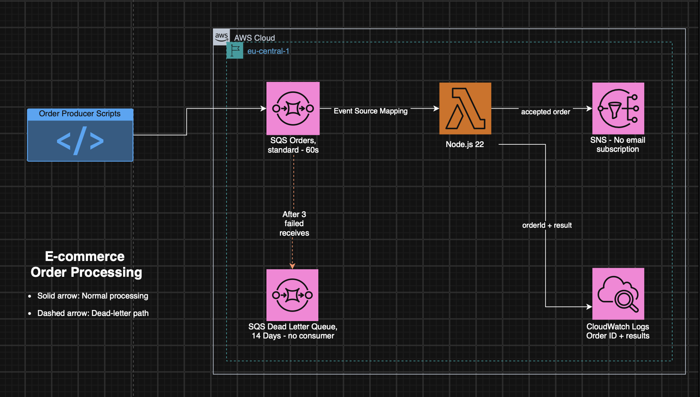
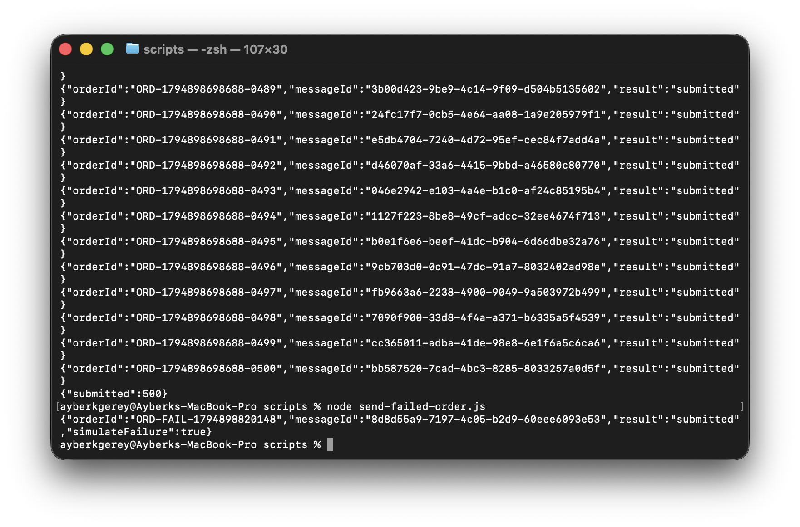
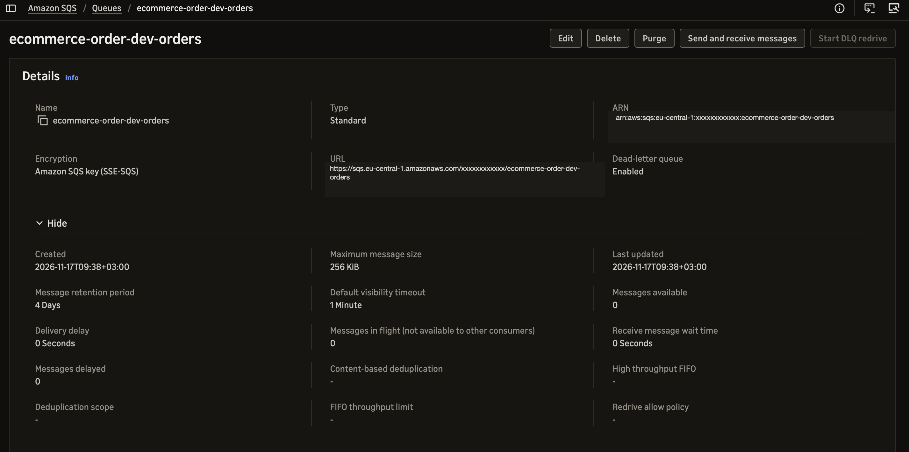
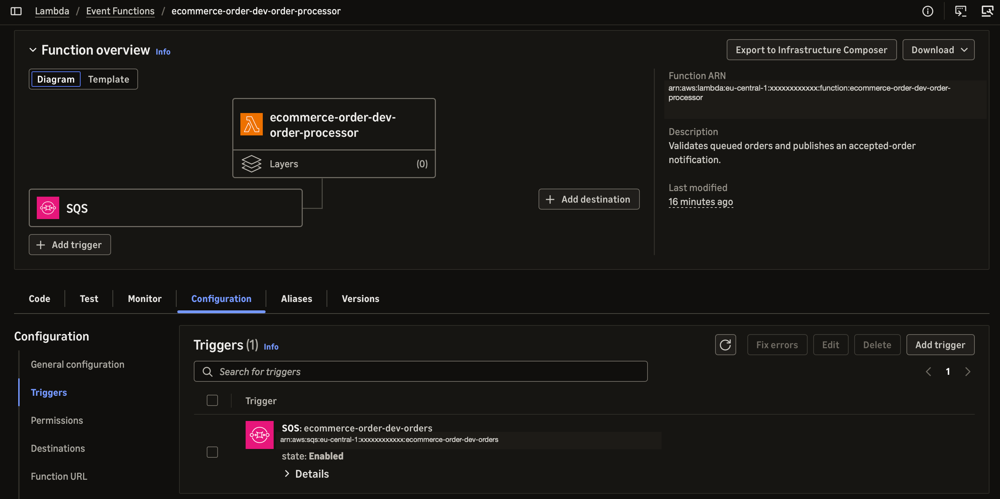
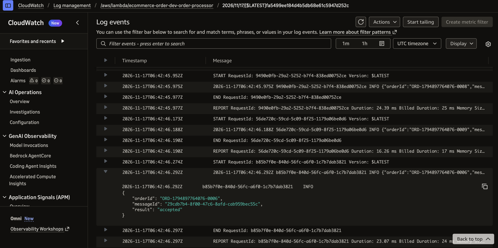
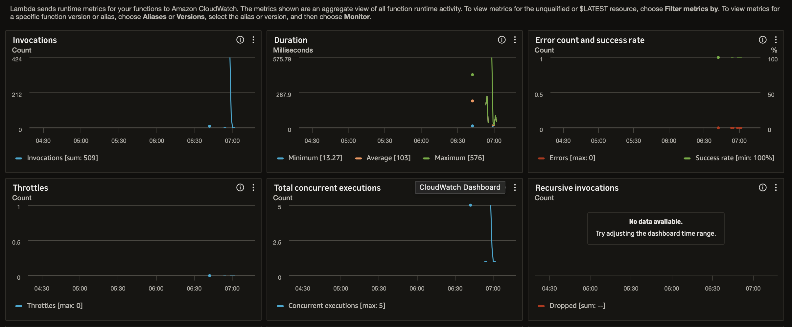
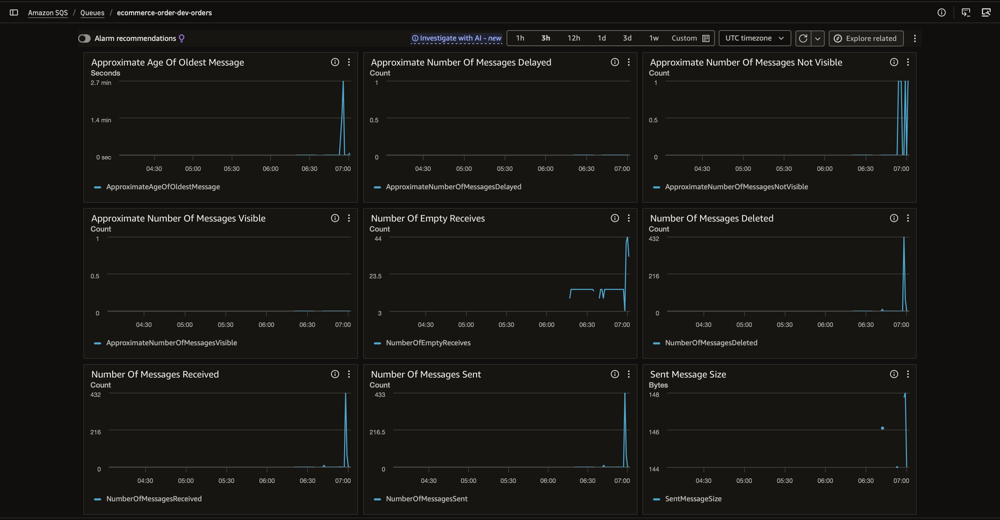
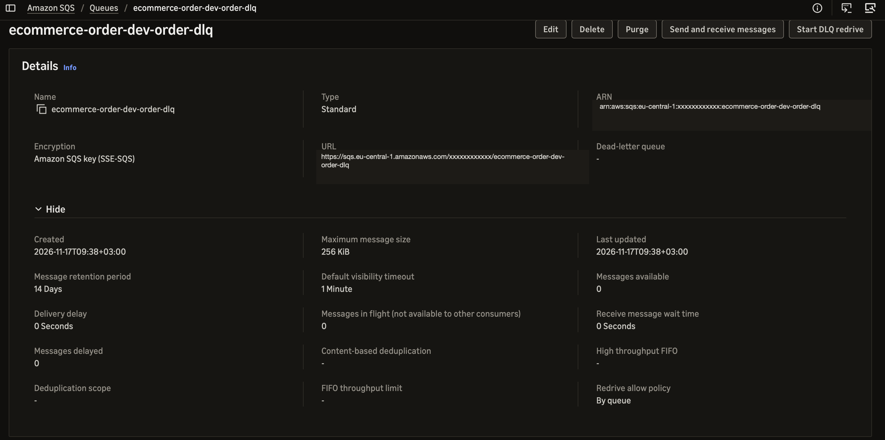
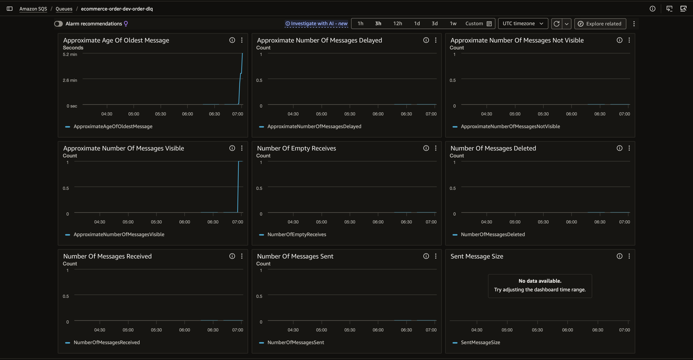

# E-Commerce Order Reliability Platform

An e-commerce company should still accept orders when notification or warehouse handling is slow. This project replaces a synchronous order flow with a small asynchronous pipeline: Amazon SQS buffers the order, one AWS Lambda function processes it, Amazon SNS announces the accepted order, and a dead-letter queue isolates a message that still fails after three attempts.

The stack is defined in Terraform and deployed in `eu-central-1`. There is no checkout UI, payment gateway, or warehouse system. The producer is a local script, which is enough to show the reliability behavior under a normal load, a 500-order burst, and a deliberate processing failure.

## The problem

During a short, high-traffic event such as Black Friday, order intake, customer notification, and warehouse handoff often run inside one request. Those steps succeed or fail together.

- A timeout in notification or warehouse handling fails an order the business could have accepted and finished later.
- The spike reaches every downstream system at once, because nothing sits between intake and processing.
- A poison message is retried in the same path as healthy orders, so one bad payload can keep coming back.
- Operators cannot easily see how deep the backlog is, how old the oldest order is, or which message has stopped succeeding.
- A blind retry can run the same side effect twice. A notification is the side effect in this lab.

The requirement is narrower than a full commerce platform. Intake must survive a downstream failure, a burst must wait in a buffer, temporary failures must be retried, permanent failures must leave the main queue, and the result must be visible in logs and metrics.

## Why the synchronous flow loses

A synchronous call chain has one advantage: the caller learns the final result before the request ends. It has a hard capacity limit. The slowest dependency sets the throughput of the whole operation, and a single timeout becomes a failed order.

An asynchronous queue reverses that tradeoff. The producer is finished when SQS accepts the message. Processing happens later, at the rate of the consumer. The customer does not get a synchronous "notification sent" response from this pipeline, and a standard queue can deliver the same message more than once. For a sale event, keeping the order and isolating the failure matters more than answering every downstream step in the original request.

## The solution





The local scripts stand in for the checkout service. They only need `sqs:SendMessage`. After SQS stores the JSON order, an event source mapping invokes the order processor with a batch of up to 10 messages. The function validates each order on its own. A valid order is published to SNS. The published message contains the order ID, product, quantity, amount, and status. It does not contain the customer email.

If one order in the batch fails, the function returns that message ID in `batchItemFailures`. Lambda deletes the successful records and SQS retries only the failed one. After three failed receives, SQS moves the message to the dead-letter queue. Nothing consumes that queue automatically. An operator inspects it and, once the cause is fixed, redrives it or deletes a pure test message.

The handler reports a failed order inside a successful invocation. Lambda's `Errors` metric therefore stays at zero for this test. The proof of failure is the log line and the dead-letter queue, not the Lambda error count.

## Why these services

| Choice | Why it is here |
| --- | --- |
| SQS Standard queue | Durable buffer. Producers and consumers fail independently. A standard queue is the right fit because the problem is spike absorption and failure isolation, not strict per-customer ordering. |
| Dead-letter queue, max receive count 3 | Three attempts cover a short processing error. A message that will never succeed then leaves the main queue instead of being retried forever. The dead-letter queue keeps it for 14 days and has no consumer. |
| One Lambda function | The business step is validation plus one notification. Lambda scales with the queue and drops back to zero when the queue is empty. There is no cluster to size and no NAT Gateway, because the function is not in a VPC. |
| Partial batch response | A ten-message batch can contain one bad order. Failing the whole invocation would retry the good orders and could publish them again. `ReportBatchItemFailures` retries only the failed message. |
| SNS | The notification is a fact about an order that already passed validation, not another work queue. Email is off unless `sns_email_endpoint` is set, so the lab does not send mail by default. |
| CloudWatch logs, no alarms | The log group is created in Terraform with 14-day retention. Invocations, duration, queue depth, and queue age already exist as service metrics. An alarm needs an on-call destination this lab does not have. |
| IAM execution role | The function can consume the order queue, publish to the topic, and write to its own log group. It cannot read the dead-letter queue. Redrive stays an operator action. |

FIFO was rejected on purpose. FIFO adds order and a deduplication window, with lower throughput. Deduplication still does not make the SNS publish exactly-once: if the function publishes and crashes before deleting the message, SQS delivers that same message again. EventBridge, Step Functions, and a second queue would add moving parts without a second business system to protect. DynamoDB would be the usual idempotency store, and it is intentionally absent. This pipeline can emit two notifications for one order. That limit is documented instead of hidden behind a half-built lock.

A longer comparison is in [docs/architecture-decisions.md](docs/architecture-decisions.md).

## What the run showed

The commands below sent 10 valid orders, then 500, then one order with `simulateFailure` set to `true`. SQS returns a message ID only after it accepts the message. The terminal shows the end of the 500-order run and the failed order being accepted into the queue.



### Normal processing

The order queue is a standard queue in `eu-central-1`, encrypted with SQS-managed SSE, retaining messages for 4 days, with a 60-second visibility timeout and a dead-letter queue enabled. The details page shows zero messages available because this picture was taken after Lambda had already deleted them.



Lambda is invoked by that queue. The trigger is enabled.



CloudWatch Logs shows one accepted order per processed message, including the order ID and the SQS message ID. These invocations finished in about 16–25 ms. The customer email is not logged.



Across the run, Lambda recorded 509 invocations, a 100% success rate, zero throttles, and a peak of 5 concurrent executions. Average duration was about 100 ms. `Errors` stayed at zero, including during the deliberate failure, because the function caught that failure and returned it as a partial batch item failure.



### The 500-order burst

The producer sends orders one at a time, and each order takes only a few tens of milliseconds to process. Lambda therefore kept up with the script. The queue's visible-message graph stays near zero. That is not a missed test. A backlog appears when the producer is faster than the consumer. Here the useful evidence is that sent, received, and deleted counts spike together, while the age of the oldest message still moves, to about 2.7 minutes. Orders were buffered and then drained. They were not processed inside the producer's request.



`NumberOfEmptyReceives` climbs while the queue is idle. The event source mapping polls SQS even when there is nothing to process. An empty receive is not a failed order.

### The isolated failure

`send-failed-order.js` submits an otherwise valid order with `simulateFailure: true`. The function rejects that one message. After three receives, SQS moves it to `ecommerce-order-dev-order-dlq`. The dead-letter queue retains messages for 14 days, allows redrive only from the source queue, and has no Lambda trigger. Its visible-message count rises to 1, and the age of that message climbs, while received and deleted counts on the dead-letter queue stay at zero. Nobody is automatically putting the poison message back into processing.





The details page can show zero messages available a moment later if the message was already deleted or had not arrived yet. The monitoring graph is the record of the message sitting in the queue.

To recover, inspect the body first. A managed redrive copies that body unchanged, so this lab message fails again if it is redriven while `simulateFailure` is still `true`. Delete it after inspection, or fix the function before redriving a real message. The console steps are in [docs/failure-scenarios.md](docs/failure-scenarios.md).

## What this project does not claim

SQS Standard is at-least-once. A successful SNS publish followed by a timeout can process the same order again and publish a second notification. There is no persistent idempotency key. A production processor would record the order ID before treating the notification as final.

`simulateFailure` is a test switch on the message body. Anyone who can send to the queue can set it. It is not an authorization control, and it should be removed before the function processes real orders.

## Deploy

Use the AWS CLI profile that can access the target account. Do not put access keys in the code or in Terraform. If `AWS_PROFILE` is set to a name that does not exist, the SDK reports that it could not load credentials. Omit the variable to use the default profile.

```bash
cd terraform
terraform init       # download providers; creates nothing in AWS
terraform validate   # local consistency check
terraform plan       # show the changes; creates nothing until apply
terraform apply      # create the resources after you confirm the plan
```

Copy `order_queue_url` from the apply output.

```bash
cd scripts
npm install
export AWS_REGION=eu-central-1
export QUEUE_URL="paste-order_queue_url-here"
node send-orders.js 10
node send-orders.js 500
node send-failed-order.js
```

The order count must be from 1 to 1000. The scripts read credentials from the default AWS chain and never contain keys. Scenario checks and the redrive procedure are in [docs/testing.md](docs/testing.md).

## Layout

```text
terraform/             # SQS, DLQ, IAM, Lambda, SNS, log group
src/order-processor/   # Lambda source; the zip contains index.js only
scripts/               # Local producers
docs/                  # Problem, decisions, failures, security, testing
screenshots/           # Diagram and console evidence from the lab run
```

Terraform defaults: Lambda 256 MB and 10 seconds, visibility timeout 60 seconds, batch size 10, maximum receive count 3, main-queue retention 4 days, dead-letter retention 14 days, log retention 14 days. The Node.js 22 runtime supplies AWS SDK for JavaScript v3, so the deployment package does not include `node_modules`.

`terraform.tfvars` and local state are gitignored. State can contain resource identifiers and, if set, the notification email. After `terraform init`, commit `.terraform.lock.hcl`. It pins provider versions and does not contain account data.

## Cost and cleanup

The lab uses SQS Standard, one small function, one SNS topic, and one log group. It does not use EC2, RDS, NAT Gateway, API Gateway, customer-managed KMS keys, or CloudWatch alarms. The 500-order run stays far inside the Lambda, SQS, and SNS free tiers. Run `terraform destroy` from `terraform/` when you are finished. Destroy deletes the queues and any messages still in them.

## Security

The execution role is limited to the order queue, the notification topic, and this function's log group. Queues use SQS-managed encryption. The topic is private to the account and has no email subscription unless you set one. Details are in [docs/security.md](docs/security.md).

## Further reading

- [Business problem](docs/business-problem.md)
- [Architecture](docs/architecture.md)
- [Architecture decisions](docs/architecture-decisions.md)
- [Failure scenarios](docs/failure-scenarios.md)
- [Security](docs/security.md)
- [Testing](docs/testing.md)
