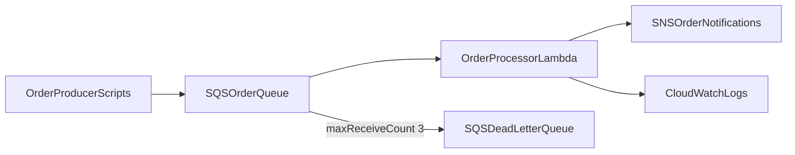

# Architecture

This is the runtime view of the order platform. The reasons for each choice are in [architecture-decisions.md](architecture-decisions.md).



## Order message

Producers send this JSON body. `simulateFailure` is a lab switch. Production traffic should not use it.

```json
{
  "orderId": "ORD-1001",
  "customerEmail": "customer@example.com",
  "product": "Laptop",
  "quantity": 1,
  "amount": 1200,
  "simulateFailure": false
}
```

Required fields are `orderId`, `customerEmail`, `product`, `quantity`, and `amount`. `quantity` must be a positive integer. `amount` must be a non-negative number.

## Path of a healthy order

1. `scripts/send-orders.js` calls `SendMessage` on the standard order queue. The script's job ends when SQS accepts the message.
2. The queue stores the message for up to four days. Other producers can continue to send while processing catches up.
3. The event source mapping invokes the order processor with up to 10 messages.
4. For each record, the function parses the body, validates the fields, and publishes one SNS message. The published payload contains the order ID, product, quantity, amount, and status `ACCEPTED`. It does not contain the customer email.
5. The function returns no failure identifier for that record. Lambda deletes it from the queue.
6. CloudWatch Logs receives one JSON line with the order ID, the SQS message ID, and `result: accepted`.

## Path of a failed order

1. `scripts/send-failed-order.js` sends the same shape with `simulateFailure` set to `true`. An invalid body fails in the same way.
2. The function catches the error for that record only. Other records in the batch are still processed.
3. The return value lists that SQS message ID in `batchItemFailures`.
4. Lambda deletes the successful records and makes the failed record visible again after the visibility timeout, which is 60 seconds by default.
5. Each receive counts toward `maxReceiveCount`. After three failed receives, SQS moves the message to the dead-letter queue.
6. The dead-letter queue keeps it for 14 days. Nothing consumes that queue automatically. An operator inspects it and, after fixing the cause, redrives it to the source queue.

## Delivery semantics

The queue is a standard queue, not a FIFO queue. SQS Standard can deliver a message more than once, and two copies can be processed close together. The function does not remember that it has already published a notification for an order ID. A timeout after a successful `Publish` can therefore send a second notification when SQS delivers the message again.

That behavior is expected for this design. Exactly-once processing would require a durable idempotency record written before the notification is treated as final. This project documents that requirement and does not pretend the queue provides it.

## Operational defaults

| Setting | Value |
| --- | --- |
| Region | `eu-central-1`, overridable with `aws_region` |
| Lambda runtime | Node.js 22 |
| Lambda memory | 256 MB |
| Lambda timeout | 10 seconds |
| Visibility timeout | 60 seconds |
| Batch size | 10 |
| Partial batch response | `ReportBatchItemFailures` |
| Maximum receive count | 3 |
| Main queue retention | 4 days |
| Dead-letter retention | 14 days |
| Queue encryption | SQS-managed SSE |
| Log retention | 14 days |
| Email subscription | Off unless `sns_email_endpoint` is set |

Resource names use `ecommerce-order-dev` unless `project_name` or `environment` is changed. The Lambda log group is created by Terraform at `/aws/lambda/<function-name>` so the function does not need permission to create log groups.
